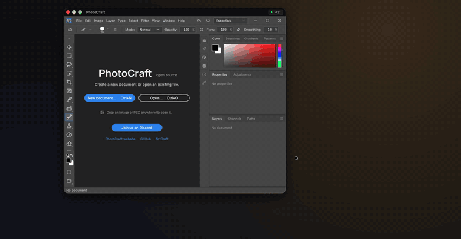

<p align="center">
  
</p>

<h1 align="center">SolStream</h1>

<p align="center">
  <strong>Run a Windows app on your Mac, in a window of its own.</strong>
</p>

<p align="center">
  <a href="https://github.com/Bruno-Alumn/SolStream/releases/latest"></a>
  
  
</p>

<p align="center">
  
</p>

Pick an app on your PC and it opens on your Mac as an ordinary window: move
it, resize it, full-screen it, ⌘-Tab to it. The app keeps running on the PC,
which does the work; the Mac shows it and sends your keyboard and mouse back.
No remote desktop, no second screen to manage.

<p align="center">
  
  <br><sub>Resize the window and the app on the PC re-lays itself out. Nothing is stretched.</sub>
</p>

## Highlights

| | |
| --- | --- |
| **One window per app** | Stream several apps at once, each in its own Mac window. |
| **Sized to your Mac** | Apps run on a virtual display that matches your Mac, so your PC's own monitor is left alone. |
| **Fast** | Hardware H.264 over SolStream's own UDP transport: 49 fps at 3600×2338 in testing. |
| **Your keyboard** | Keys are sent by position and the PC's layout decides what they type. Caps Lock stays in step. |
| **App sound** | Only the streamed apps on Windows 11, the whole PC on Windows 10. Opus or lossless. |
| **Gaming mode** | Games get raw mouse movement. ⌃⌥ gives you the mouse back. |
| **Recovers by itself** | After a Wi-Fi drop, a network change or the PC's host restarting. |
| **Private** | Paired with a token; every packet encrypted with AES-256-GCM. |
| **Signed updates** | Both programs find new releases, verify their signature and ask before installing. |

## Install

You need a Mac with **macOS 14 or later** and a PC with **Windows 10 or 11**, on
the same network or both on [Tailscale](https://tailscale.com/download).
Download both files from the
[latest release](https://github.com/Bruno-Alumn/SolStream/releases/latest):

| | Download | Then |
| --- | --- | --- |
| **Mac** | `SolStream-X.Y.Z-macOS.dmg` | Drag SolStream into Applications. |
| **PC** | `SolStreamSetup-X.Y.Z.exe` | Run it, and leave *Set up a virtual display* ticked. |

Neither download carries a paid signature yet, so each system warns you once:

- **Mac:** open SolStream, close the warning, then System Settings → Privacy &
  Security → *Open Anyway*.
- **PC:** on "Windows protected your PC", click *More info* → *Run anyway*.

Setup installs the host, opens its ports in the firewall and starts it at
every sign-in, quietly, in the tray.

## Quick start

1. **Open SolStream on the Mac.** It finds the PC on your network. If it
   doesn't, type the PC's name or address into the host list.
2. **Pair once.** Click SolStream's tray icon on the PC and type the token it
   shows into the Mac.
3. **Pick an app**: a window that's already open, or anything from the Start
   menu. It opens in its own Mac window.

## While streaming


Click the **frame rate** in a window's title bar for volume, sound quality,
video quality and the mouse mode.

- **Desktop mouse** puts the PC's pointer exactly where yours is. Use it for
  ordinary apps.
- **Gaming mouse** hands the mouse to the game when you click in. Press
  **⌃⌥** to get it back. Games that show a pointer in their menus give it back
  by themselves.
- **Title bar → Hide** removes the PC's own title bar from apps that draw
  one, like Chrome, Discord and File Explorer.

Everything else is in **SolStream › Settings**.

<br clear="right">

## Troubleshooting

<details>
<summary><strong>The Mac doesn't find the PC</strong></summary>

The Mac looks for the PC with a broadcast on UDP 47629, which doesn't cross
routers or VPNs. Type the PC's name or address into the host list instead. To
reach the PC from another network, install Tailscale on both machines and
sign in to the same account. Setup opens TCP 47630 and UDP 47629 and 47631 in
Windows Firewall; a third-party firewall needs the same.
</details>

<details>
<summary><strong>Clicks and keys don't reach one app</strong></summary>

The host runs without administrator rights, and Windows doesn't let it control
apps that run as administrator, or Windows' own admin prompts. Answer those at
the PC, or start the app without administrator rights.
</details>

<details>
<summary><strong>I hear the whole PC, not just the app</strong></summary>

Sound from individual apps needs Windows 11. On Windows 10 SolStream sends
everything the PC plays.
</details>

<details>
<summary><strong>Uninstalling</strong></summary>

- **Mac:** quit SolStream and drag it to the Trash. Pairings are kept in
  `~/Library/Application Support/SolStream`; delete that folder too to forget
  them.
- **PC:** Settings → Apps → SolStream → *Uninstall*. It removes the host, its
  firewall rules, its sign-in task and the virtual display it installed.
</details>

## Updates and security

Both programs check for a new release a minute after they start and then once
a day, or when you choose *Check for Updates*. Nothing installs until you say
so, and never in the middle of a stream. Every release's checksums are signed,
and a download that doesn't match the key built into both programs is thrown
away ([how](docs/updates.md)).

A Mac has to prove it knows the PC's pairing token before the host does
anything, and from then on the control channel and every media packet are
encrypted. Keep the host on a network you trust, or reach it over a VPN such
as Tailscale. To report a vulnerability, see [SECURITY.md](SECURITY.md).

## How it works

```
   macOS                                  Windows
   ┌───────────────────┐                  ┌────────────────────────┐
   │ SolStream.app     │  control, TCP    │ SolStream.exe          │
   │  picker           │◄────47630───────►│  windows, apps, launch │
   │  window + decode  │   encrypted      │  window placement      │
   │  input capture    │                  │  keys for the session  │
   │                   │                  │                        │
   │                   │  SMT/1, UDP      │  Windows.Graphics      │
   │                   │◄────47631───────►│   .Capture             │
   │                   │  AES-256-GCM     │  hardware H.264        │
   └───────────────────┘                  │  per-app sound, Opus   │
                                          └───────────┬────────────┘
                                                      │ captures
                                                      ▼
                                              virtual display
```

The **host** on the PC moves the app onto the virtual display, captures it and
encodes it on the graphics card. The **Mac client** decodes it with
VideoToolbox, cuts each app out of the picture for a window of its own, and
sends your keyboard and mouse back. The two talk over an encrypted TCP control
channel and SMT/1, SolStream's own UDP media transport
([design](docs/transport-smt1.md)).

<details>
<summary><strong>Building from source</strong></summary>

**Mac client** (Xcode command-line tools, macOS 14 or later):

```bash
cd macos/SolStreamClient && swift build && swift test
```

`scripts/package-macos.sh --dev` makes the `.app`, `.zip` and `.dmg`; add
`--universal` to include Intel Macs.

**Windows host** (CMake and Visual Studio's C++ tools):

```
cmake --build build --target SolStreamAgent --config Release
```

`scripts/package-windows.ps1` makes `dist\SolStreamSetup-X.Y.Z.exe`, which is
the whole installer. On a Mac, `sh windows/SolStreamAgent/build-cross.sh`
checks that the Windows code compiles; only MSVC builds the real thing.

Releases are cut by tagging; see [`docs/releasing.md`](docs/releasing.md).

| Path | What's in it |
| --- | --- |
| `macos/SolStreamClient/` | The Mac app, a Swift package. |
| `windows/SolStreamAgent/` | The Windows host ([README](windows/SolStreamAgent/README.md)). |
| `windows/SolStreamAgent/media/` | Capture, encoding, sound and the transport. |
| `windows/VirtualDisplay/` | The virtual display setup. |
| `scripts/` | Packaging and release signing. |
| `docs/` | Design notes, and the pictures in this README. |

</details>

## Licence

All rights reserved; there is no open-source licence. You may read the code
here, but not copy, change or redistribute it without the owner's permission.

The Windows host includes [libopus](https://opus-codec.org) 1.6.1 (BSD
3-clause) for sound ([why](third_party/opus/SOLSTREAM.md);
`SolStream.exe --licenses` prints its licence). The
[Virtual Display Driver](https://github.com/VirtualDrivers/Virtual-Display-Driver)
(MIT) isn't bundled: setup downloads a pinned, hash-checked release and
uninstalling removes it ([details](installer/README.md)). Everything else comes
with macOS and Windows.
