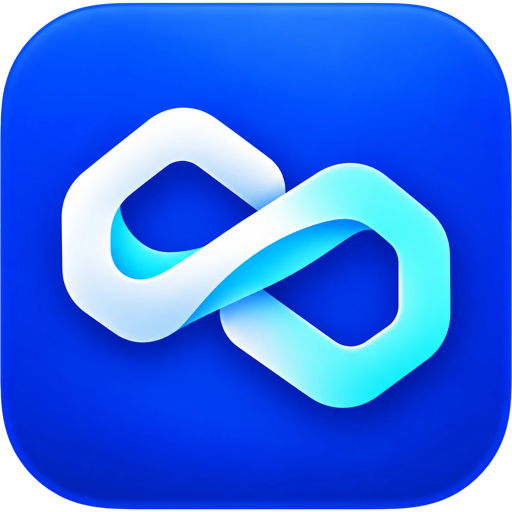
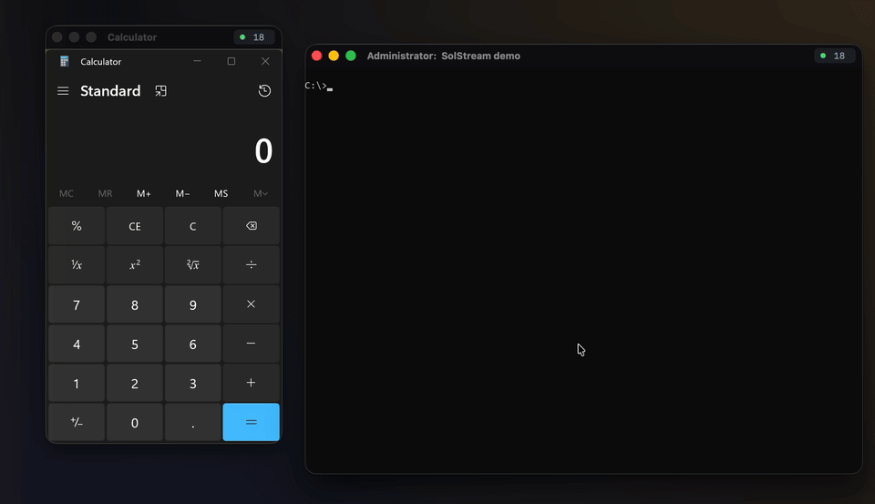
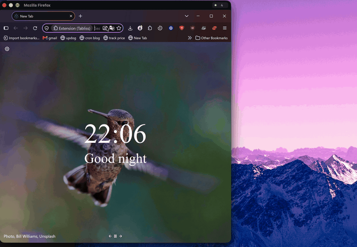
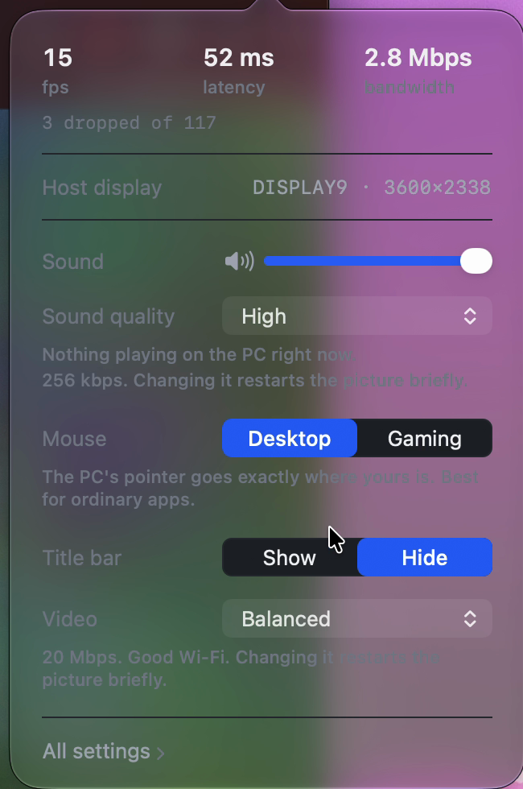

<p align="center">
  
</p>

<h1 align="center">SolStream</h1>

<p align="center">
  Windows apps on your Mac, each in a native window.
</p>

<p align="center">
  <a href="https://github.com/Bruno-Alumn/SolStream/releases/latest"></a>
  
  
</p>

<p align="center">
  
</p>

SolStream streams individual applications from a Windows PC to a Mac. Each
app appears as a regular macOS window that you can move, resize, put in full
screen and switch to with ⌘-Tab, while the app itself keeps running on the PC.

<p align="center">
  
  <br><sub>Resizing the Mac window resizes the app on the PC, so its layout adapts instead of being scaled.</sub>
</p>

## Features

| | |
| --- | --- |
| **Window per app** | Stream several apps at once, each in its own Mac window. |
| **In the Dock** | Add a Windows app to the Dock, and find it in Spotlight and Launchpad. |
| **Clipboard and files** | Copy and paste text and pictures both ways. Drop files on a window to send them to the PC. |
| **Dedicated display** | Apps run on a virtual display sized to your Mac, leaving the PC's monitor untouched. |
| **Low latency** | Hardware H.264 encoding over a purpose-built UDP transport; 49 fps at 3600×2338 in testing. |
| **Keyboard layouts** | Keys are sent by position and typed with the PC's layout. Caps Lock stays in sync. |
| **Per-app sound** | Audio from the streamed apps only on Windows 11, or the whole PC on Windows 10. Opus or lossless. |
| **Gaming mode** | Raw mouse input for games. Press ⌃⌥ to release the mouse. |
| **Automatic recovery** | Reconnects after Wi-Fi drops, network changes and host restarts. |
| **Encrypted** | Pairing token authentication; AES-256-GCM on every packet. |
| **Signed updates** | Both apps check for new releases, verify the signature and ask before installing. |

## Requirements

- A Mac with **macOS 14** or later
- A PC with **Windows 10 or 11**; a GPU with a hardware video encoder is strongly
  recommended
- Both on the same network, or both on [Tailscale](https://tailscale.com/download)

## Installation

Download both installers from the
[latest release](https://github.com/Bruno-Alumn/SolStream/releases/latest).

| | File | Steps |
| --- | --- | --- |
| **Mac** | `SolStream-X.Y.Z-macOS.dmg` | Drag SolStream into Applications. |
| **PC** | `SolStreamSetup-X.Y.Z.exe` | Run it and keep *Set up a virtual display* selected. |

The installers are not yet signed with a paid certificate, so each system
shows a warning the first time:

- **Mac:** open SolStream, dismiss the warning, then choose *Open Anyway* in
  System Settings → Privacy & Security.
- **PC:** on the "Windows protected your PC" screen, choose *More info* →
  *Run anyway*.

Setup installs the host, adds its firewall rules and starts it in the system
tray at sign-in.

## Getting started

1. **Open SolStream on the Mac.** It discovers the PC on the local network. If
   the PC isn't listed, enter its name or IP address in the host list.
2. **Pair.** Click the SolStream icon in the PC's system tray and enter the
   pairing token it shows. This is needed once per PC.
3. **Choose an app.** Pick an open window or any app from the Start menu. It
   opens in its own window on the Mac.

## Using SolStream



The frame rate in each window's title bar opens the stream controls: volume,
sound quality, video quality and mouse mode.

- **Desktop mouse** keeps the PC's pointer under yours. Use it for ordinary
  apps.
- **Gaming mouse** gives the game raw mouse input once you click into the
  window. Press **⌃⌥** to release it. Games that show a cursor in their menus
  release it automatically.
- **Title bar → Hide** removes the app's own title bar for apps that draw one,
  such as Chrome, Discord and File Explorer.
- **Add to Dock**: right-click an app in the list, or choose
  **Add … to Dock** from the Host menu while it's open. Clicking it in the Dock, Spotlight or
  Launchpad connects to the PC and opens it. The launchers are kept in
  `~/Applications/SolStream Apps`.
- SolStream reopens the app you were streaming when you quit. Turn this off
  in Settings.
- **Drop files** on a window to send them to the PC. They're saved in
  `Downloads\SolStream` there and put on its clipboard: press **⌘V** to paste
  them into the app.

Other settings are in **SolStream › Settings**.

<br clear="right">

## Troubleshooting

<details>
<summary><strong>The Mac doesn't find the PC</strong></summary>

Discovery uses a broadcast on UDP 47629, which doesn't cross routers or VPNs.
Enter the PC's name or IP address in the host list instead. To connect from
another network, install Tailscale on both machines and sign in to the same
account. Setup opens TCP 47630 and UDP 47629 and 47631 in Windows Firewall;
third-party firewalls need the same ports open.
</details>

<details>
<summary><strong>Clicks and keystrokes don't reach an app</strong></summary>

The host runs without administrator rights, and Windows blocks it from
controlling apps that run as administrator, including Windows' own UAC
prompts. Respond to those at the PC, or run the app without administrator
rights.
</details>

<details>
<summary><strong>I hear the whole PC instead of the app</strong></summary>

Per-app audio requires Windows 11. On Windows 10, SolStream sends all of the
PC's audio.
</details>

<details>
<summary><strong>The connection drops when I sign out of Windows</strong></summary>

The host runs inside your Windows session, so it stops when you sign out and
starts again when you sign back in. Locking the PC doesn't stop it.
</details>

<details>
<summary><strong>Uninstalling</strong></summary>

- **Mac:** quit SolStream and move it to the Trash. Pairings are stored in
  `~/Library/Application Support/SolStream`; delete that folder to remove them.
- **PC:** Settings → Apps → SolStream → *Uninstall*. This removes the host,
  its firewall rules, its sign-in task and the virtual display it installed.
</details>

## Updates and security

Both apps check GitHub for new releases on their own: the Mac app when it
opens and the PC host shortly after it starts, then once a day, or whenever
you choose *Check for Updates* (the SolStream menu on the Mac, the tray menu
on the PC). Nothing is installed without your
confirmation, and never during a stream. Each release's checksums are signed;
a download that doesn't verify against the key built into both apps is
discarded ([details](docs/updates.md)).

A Mac must prove it knows the PC's pairing token before the host accepts any
command. After that, the control channel and all media are encrypted. Run the
host on a trusted network, or reach it over a VPN such as Tailscale. To report
a vulnerability, see [SECURITY.md](SECURITY.md).

## Architecture

```
   macOS                                  Windows
   ┌───────────────────┐                  ┌────────────────────────┐
   │ SolStream.app     │  control, TCP    │ SolStream.exe          │
   │  picker           │◄────47630───────►│  windows, apps, launch │
   │  window + decode  │   encrypted      │  window placement      │
   │  input capture    │                  │  keys for the session  │
   │                   │                  │                        │
   │                   │  SMT/1, UDP      │  Windows.Graphics      │
   │                   │◄────47631───────►│   .Capture             │
   │                   │  AES-256-GCM     │  hardware H.264        │
   └───────────────────┘                  │  per-app sound, Opus   │
                                          └───────────┬────────────┘
                                                      │ captures
                                                      ▼
                                              virtual display
```

The **host** moves the selected app onto the virtual display, captures it with
Windows.Graphics.Capture and encodes it on the GPU. The **Mac client** decodes
the stream with VideoToolbox, crops each app into its own window and sends
keyboard and mouse input back. The two communicate over an encrypted TCP
control channel and SMT/1, SolStream's UDP media transport
([specification](docs/transport-smt1.md)).

<details>
<summary><strong>Building from source</strong></summary>

**Mac client** (Xcode command-line tools, macOS 14 or later):

```bash
cd macos/SolStreamClient && swift build && swift test
```

`scripts/package-macos.sh --dev` builds the `.app`, `.zip` and `.dmg`; add
`--universal` to include Intel Macs.

**Windows host** (CMake and Visual Studio's C++ tools):

```
cmake --build build --target SolStreamAgent --config Release
```

`scripts/package-windows.ps1` builds `dist\SolStreamSetup-X.Y.Z.exe`, the
complete installer. On a Mac, `sh windows/SolStreamAgent/build-cross.sh`
checks that the Windows code compiles; release builds require MSVC.

Releases are published by pushing a version tag; see
[`docs/releasing.md`](docs/releasing.md). The icons are generated from
[`assets/logo`](assets/logo/README.md).

| Path | Contents |
| --- | --- |
| `macos/SolStreamClient/` | The Mac app, a Swift package. |
| `windows/SolStreamAgent/` | The Windows host ([README](windows/SolStreamAgent/README.md)). |
| `windows/SolStreamAgent/media/` | Capture, encoding, audio and the transport. |
| `windows/VirtualDisplay/` | Virtual display setup. |
| `assets/logo/` | The logo and the icon generator. |
| `scripts/` | Packaging and release signing. |
| `docs/` | Design notes and README media. |

</details>

## License

All rights reserved. There is no open-source license: the code may be read
here, but not copied, modified or redistributed without the owner's
permission.

The Windows host includes [libopus](https://opus-codec.org) 1.6.1 (BSD
3-clause) for audio ([notes](third_party/opus/SOLSTREAM.md); run
`SolStream.exe --licenses` to print its license). The
[Virtual Display Driver](https://github.com/VirtualDrivers/Virtual-Display-Driver)
(MIT) is not bundled: setup downloads a pinned, hash-verified release, and
uninstalling removes it ([details](installer/README.md)). Everything else is
part of macOS and Windows.
