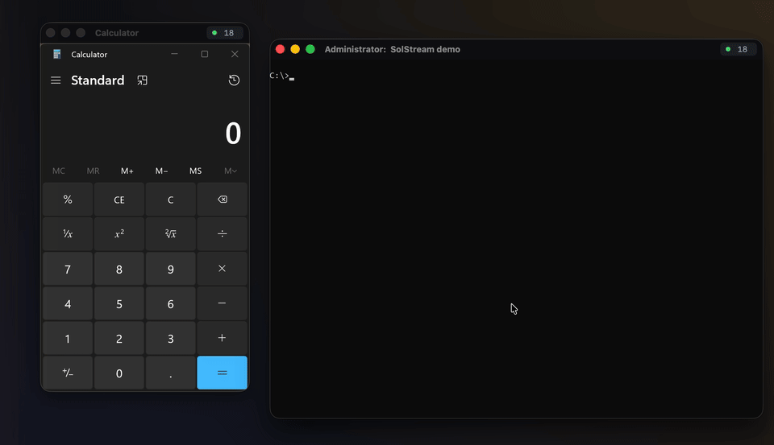
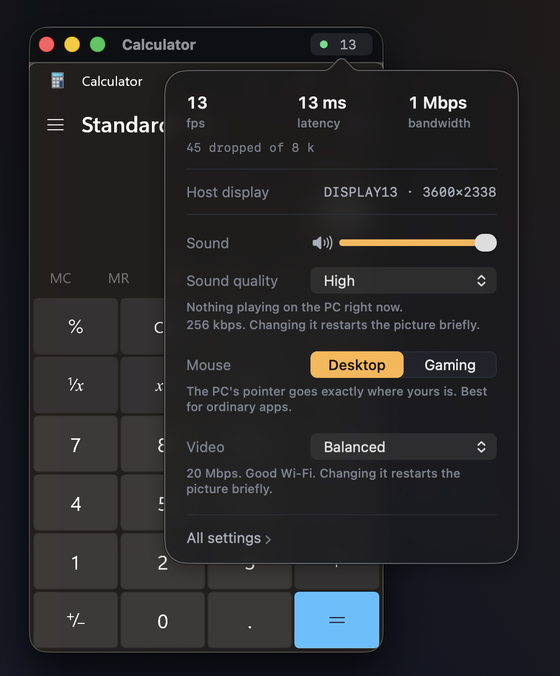

<p align="center">
  
</p>

<h1 align="center">SolStream</h1>

<p align="center">
  <strong>One Windows app on your Mac, in a window of its own.</strong><br>
  macOS 14 or later on the Mac &middot; Windows 10 or 11 on the PC &middot; current release 1.0.1
</p>

<p align="center">
  
</p>

You don't get a remote desktop. You get the app: Calculator, Photoshop or a
game turns up as a normal macOS window with traffic lights and a title bar,
which you can move, resize, full-screen and ⌘-Tab to like anything else. The
app keeps running on your PC. With any luck you stop noticing that.

Above, two apps on the PC are streamed to the Mac at the same time. The
clicks and typing come from the Mac's own mouse and keyboard.

## What it does

- **One window per app.** Each app you stream gets its own Mac window. Resize
  the window and the app is resized on the PC to match, so you see its real
  layout at its real size, not a scaled picture.
- **A screen of its own.** The PC host moves the app onto a virtual display
  sized to your Mac. Your monitor keeps whatever you had on it, and nothing
  from it ends up in the stream.
- **Quick.** The PC's own graphics card encodes the H.264,
  and SolStream sends it over its own UDP transport. In testing at 3600×2338
  it held 49 fps, and capture to send took 6.4 ms at best.
- **Your keyboard layout.** Keys are sent by position and the PC's own layout
  decides what they type, so accents, ISO and JIS keys, the keypad and F13–F20
  all come through. Caps Lock stays the same on both machines.
- **Sound from the app.** On Windows 11 you hear only the streamed apps. On
  Windows 10 you hear the whole PC. You can pick Opus or lossless.
- **Gaming mode.** For games that take over the mouse: the game gets raw
  mouse movement, and ⌃⌥ (Control-Option) gives the mouse back.
- **It recovers by itself.** After a Wi-Fi drop, a network change or a restart
  of the PC host, the window comes back without any clicking from you.
- **Paired and encrypted.** The Mac has to prove it knows a pairing token,
  and from then on the control channel and every media packet are encrypted
  with AES-256-GCM.
- **Signed updates.** Both programs look for new releases and ask
  before installing one. Each release is checked against a signature first.

## Install

Download both files from the
[latest release](https://github.com/Bruno-Alumn/SolStream/releases/latest).

| | File | What to do |
| --- | --- | --- |
| **Mac** | `SolStream-X.Y.Z-macOS.dmg` | Open it and drag SolStream into Applications. |
| **Windows PC** | `SolStreamSetup-X.Y.Z.exe` | Run it. It installs itself and asks for administrator rights once. |

The PC setup also offers to install a virtual display if the PC doesn't have
one. That option is ticked by default, and it's what gives your Mac a screen
of its own. When setup finishes it shows a checklist of what it did and what
to do next on the Mac. From then on the host starts quietly in the tray when
you log in.

Neither file is signed with a paid certificate yet, so both systems warn you
the first time:

- **Mac:** macOS says it couldn't check the app for malware. Close the
  warning, then go to System Settings → Privacy & Security and click
  *Open Anyway*.
- **PC:** SmartScreen says "Windows protected your PC". Click *More info*,
  then *Run anyway*. The administrator prompt after that says
  *Unknown publisher*. When setup installs the virtual display, Windows also
  asks once whether to trust that driver's publisher, SignPath Foundation.

## Using it

1. **Open SolStream on the Mac.** The first time, it walks you through
   setting up the PC. It finds the PC on your network by itself. To reach the
   PC away from home, install [Tailscale](https://tailscale.com/download) on
   both machines and sign in to the same account. Both apps suggest it, and
   tell you when it's off.
2. **Pair once.** Type in the pairing token shown in SolStream's window on the
   PC. Click the tray icon to see it.
3. **Pick an app.** Choose a window that's already open, or an app from the
   Start menu. It opens in its own Mac window.



Click the frame-rate number in a stream window's title bar for the controls
you'll want mid-stream: volume, sound quality, the mouse mode and video
quality. Everything else is in SolStream › Settings.

**Desktop** mouse mode is for ordinary apps: the PC's pointer goes exactly
where yours does. **Gaming** is for games that take over the mouse. Click
into the window and the mouse belongs to the game until you press ⌃⌥. In
games that show a pointer in their menus, such as Minecraft's pause screen,
you get the mouse back without pressing anything.

Some apps draw their own title bar, like Chrome, Discord and File Explorer.
For those, the same controls can hide that bar so only the app's content
shows.

<br clear="right">

## Updates

Both programs check for a new release a minute after they start, then once a
day. You can also check by hand: *Check for Updates…* in the Mac's SolStream
menu, or *Check for updates* in the tray menu on the PC.

When an update turns up you get a notice, and nothing installs until you say
so. It never installs in the middle of a stream. Every release comes with a
list of checksums, signed with a key that's built into both programs. The
updater checks that signature, then the file, and throws away anything that
doesn't match.

- The Mac app replaces itself, so it has to be somewhere you can write to,
  such as Applications. If it can't write there, it tells you instead of
  asking for an administrator password.
- macOS may ask for Local Network access again after an update.
- On Windows, installing an update asks for administrator rights, as the
  first install did.

<details>
<summary><strong>While this repository is private</strong></summary>

GitHub hides a private repository's releases from anyone who isn't signed in,
so the updaters find nothing and say nothing. The same goes for the *Get it*
links in both apps' setup guides. They open the releases page, which shows a
404 unless you're signed in with an account that can see the repository.

To test updates in the meantime, create a fine-grained personal access token
for this repository only, with *Contents: Read-only* and an expiry date. Then
give it to the program as `SOLSTREAM_GITHUB_TOKEN`:

- **Mac:** quit SolStream, run this in Terminal and paste the token when it
  asks:

  ```bash
  /bin/bash -c 'read -rsp "Token: " t && SOLSTREAM_GITHUB_TOKEN="$t" exec open -a SolStream'
  ```

  The token only exists for that one launch. Don't use `launchctl setenv`,
  which hands it to every app you open.
- **PC:** add it as a *user* variable under *Edit environment variables for
  your account* in the Start menu. Don't make it a system variable, which every
  account on the PC can read. Then quit SolStream from the tray and start it
  again.

Once the repository is public none of this is needed, and you can delete the
token. [`docs/updates.md`](docs/updates.md) has the details.

</details>

## How it works

There are two programs, and a protocol of their own between them.

The **host** runs on the PC. It lists your windows and installed apps and
starts apps when asked. It moves the app you're streaming onto the virtual
display. It captures that display with Windows.Graphics.Capture, encodes it on
the graphics card and sends it, along with the app's sound.

The **Mac client** shows the app picker and decodes the video with
VideoToolbox. It cuts each app's window out of the picture for a window of its
own, and sends your keyboard and mouse back.

They talk over a TCP control channel and SMT/1, SolStream's own media
transport: plain UDP with AES-256-GCM on every packet. Keys for both are
agreed once the Mac has proved it knows the pairing token. The design is in
[`docs/transport-smt1.md`](docs/transport-smt1.md).

```
   macOS                                  Windows
   ┌───────────────────┐                  ┌────────────────────────┐
   │ SolStream.app     │  control, TCP    │ SolStream.exe          │
   │  picker           │◄────47630───────►│  windows, apps, launch │
   │  window + decode  │   encrypted      │  window placement      │
   │  input capture    │                  │  keys for the session  │
   │                   │                  │                        │
   │                   │  SMT/1, UDP      │  Windows.Graphics      │
   │                   │◄────47631───────►│   .Capture             │
   │                   │  AES-256-GCM     │  hardware H.264        │
   └───────────────────┘                  │  per-app sound, Opus   │
                                          └───────────┬────────────┘
                                                      │ captures
                                                      ▼
                                              virtual display
```

The Mac finds the PC on your network with a broadcast on UDP 47629. On a real
PC at 3600×2338, with full-screen content the graphics card redraws all the
time, it held 49 fps without losing a frame. Capture to the last byte leaving
the PC took 6.4 ms at best and 20.6 ms on average.

## Building

**Mac client.** You need Xcode's command-line tools on macOS 14 or later.

```bash
cd macos/SolStreamClient && swift build && swift test
```

`scripts/package-macos.sh --dev` builds `SolStream.app`, and from it
`dist/SolStream-X.Y.Z-macOS.zip` and `.dmg`. Add `--universal` to include Intel
Macs, as releases do. The version always comes from the `VERSION` file.

**Windows host.** You need CMake and Visual Studio's C++ tools (MSVC).

```
cmake --build build --target SolStreamAgent --config Release
```

`scripts/package-windows.ps1` turns that into `dist\SolStreamSetup-X.Y.Z.exe`.
That one file is the whole installer. Run it and it copies itself into
Program Files, opens the three ports it needs and sets itself to start when you
log in. `--uninstall` undoes all of it.

On a Mac you can check that the Windows code compiles with
`sh windows/SolStreamAgent/build-cross.sh`, which uses mingw. Only MSVC builds
the real thing, though. The capture and encoding code needs C++/WinRT and
Media Foundation, which mingw doesn't have.

Releases are described in [`docs/releasing.md`](docs/releasing.md).

## Where things are

| Path | What's in it |
| --- | --- |
| `macos/SolStreamClient/` | The Mac app, a Swift package. |
| `macos/SolStreamClient/Sources/MediaSession/` | The Mac half of SMT/1. |
| `windows/SolStreamAgent/` | The Windows host. It has its own [README](windows/SolStreamAgent/README.md). |
| `windows/SolStreamAgent/media/` | The PC half of SMT/1: capture, encode, packetize, pace, send. |
| `windows/VirtualDisplay/` | How the virtual display is set up. |
| `scripts/` | Packaging for both platforms, and release signing. |
| `.github/workflows/` | CI and the release pipeline. |
| `docs/` | Design notes, and the pictures in this README. |
| `spike/` | Small throwaway programs, each written to answer one question and kept for the answer. |

## Licence

All rights reserved. SolStream has no open-source licence. If you can see this
repository you may read the code, but you may not copy, change or
redistribute it without the owner's permission.

The Windows host includes one outside library,
[libopus](https://opus-codec.org) 1.6.1 (BSD 3-clause), which compresses the
sound unless you choose lossless. Windows has no Opus encoder of its own, and
its built-in AAC encoder can't do 64 or 256 kbit/s and adds about 50 ms of
delay. [`third_party/opus/SOLSTREAM.md`](third_party/opus/SOLSTREAM.md) says
what was taken and why, and `SolStream.exe --licenses` prints the licence.
The Mac decodes Opus with AudioToolbox.

The [Virtual Display Driver](https://github.com/VirtualDrivers/Virtual-Display-Driver)
(MIT) isn't bundled. Setup offers to download one pinned, hash-checked release
of it and install it, and uninstalling SolStream removes it again. See
[`installer/README.md`](installer/README.md).

Everything else comes with the operating systems: BCrypt, Media Foundation and
Windows.Graphics.Capture on Windows; CryptoKit, VideoToolbox, AudioUnit and
AudioToolbox on the Mac. Earlier versions used
[Sunshine](https://github.com/LizardByte/Sunshine) (GPL-3.0) and
[ENet](https://github.com/lsalzman/enet) (MIT). SolStream does that work itself
now, so nothing it ships is under the GPL.
